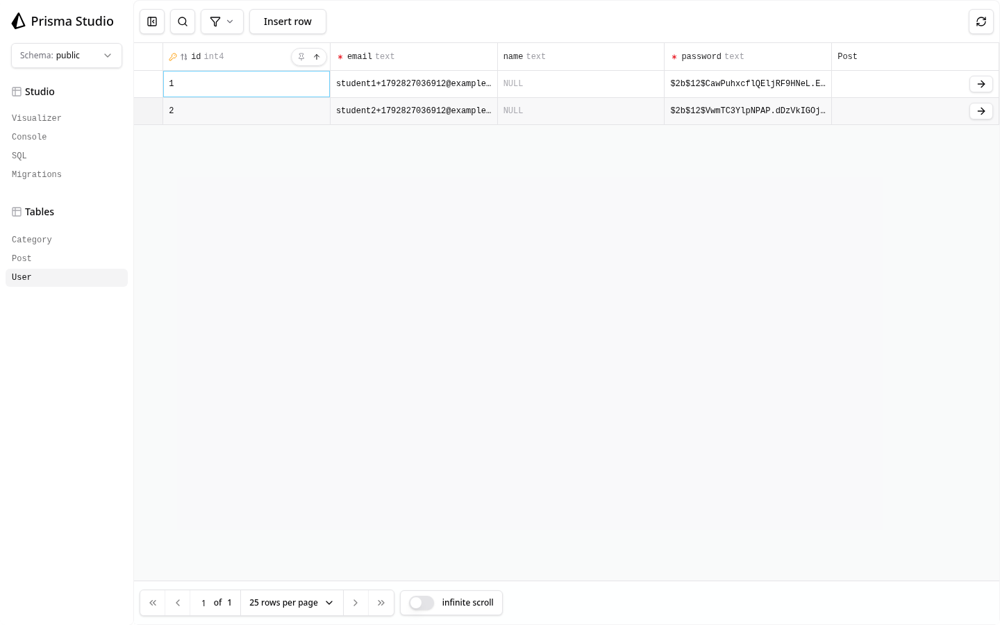
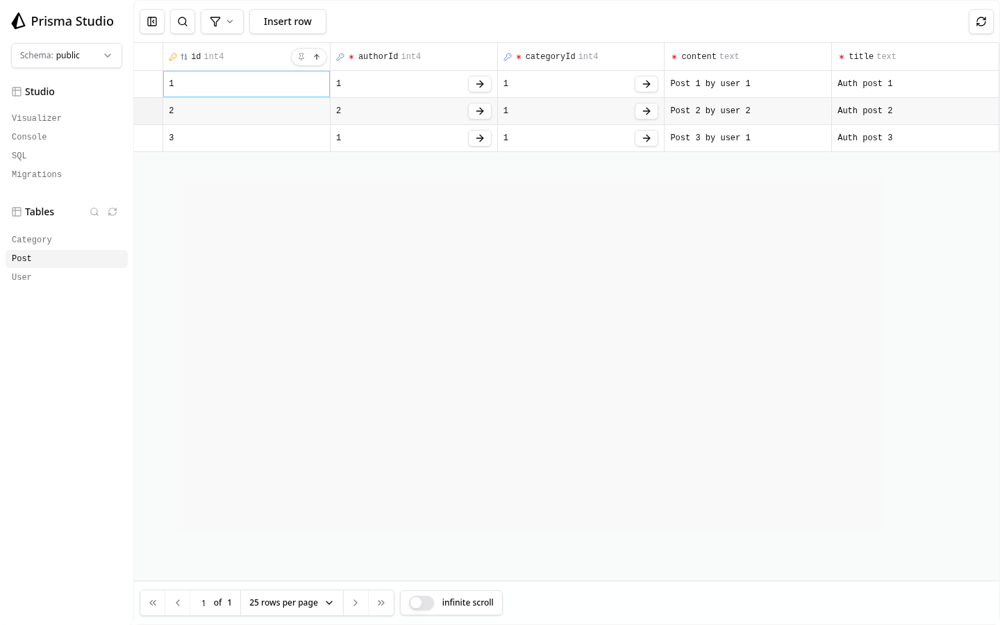
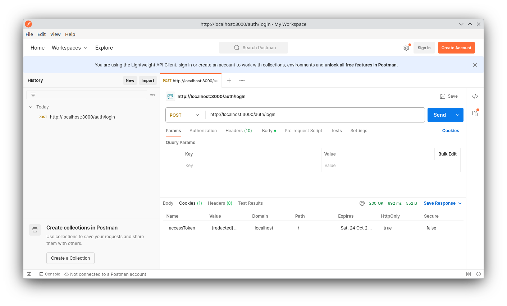

# Перевірка користувачів і авторизації

Локально перевірено на PostgreSQL 17.11 і Node.js 22.23.2.

- `npx tsc --noEmit` — без помилок.
- `npm run contract:emit`, `npm run db:init`, `npm run db:verify` — успішно для чистої БД.
- [Колекція Postman](../postman/forum-api-auth.postman_collection.json) виконана через Newman: 11 запитів, 19 перевірок, 0 помилок. Зареєстровано двох користувачів, отримано `accessToken` у `HttpOnly` cookie, перевірено 409 і 401, створено три дописи від двох авторів. [Підсумок результатів](postman-auth-results.json) не містить паролів і токенів.
- Оновлена [колекція дописів і категорій](../postman/forum-api.postman_collection.json) на окремій чистій БД: 30 запитів, 84 перевірки, 0 помилок. Категорії, фільтри та попередні коди помилок збережено.
- Окремо перевірено оновлення БД з попередньої структури: до перенесення було 2 категорії та 3 дописи; після `scripts/migrate-post-authors.sql` і `db:update` є 2 категорії, 3 дописи, 2 користувачі та 3 коректні зв'язки `Post.authorId → User.id`. `db:verify` успішний.
- [Приклад GET /posts із вкладеним author](get-posts-auth.json). Поле `password` у відповіді відсутнє.

## User у Prisma Studio

## Post у Prisma Studio

## Cookie після login у Postman

Значення тестового токена приховано на скріншоті. Видно ім'я `accessToken` і прапорець `HttpOnly`.

