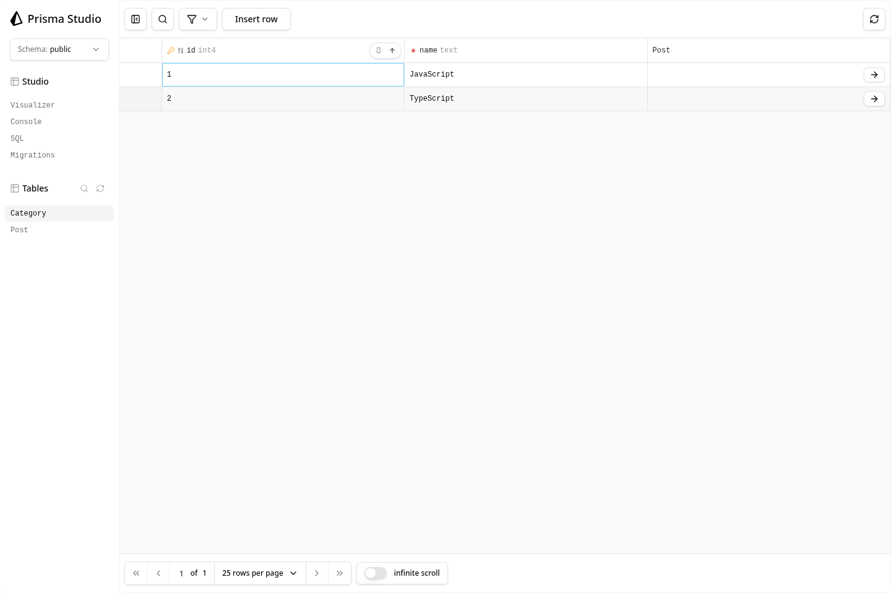
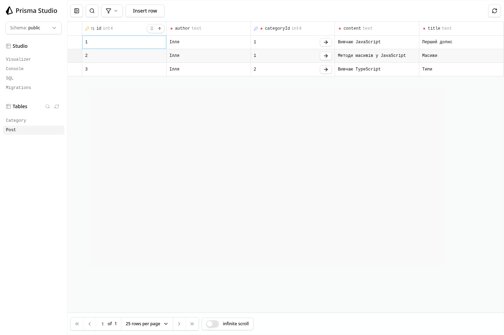

# Перевірка категорій дописів

Перевірено локально на Node.js 22.23.2 та PostgreSQL 17.11.

- `npx tsc --noEmit` — без помилок.
- `npm run contract:emit`, `npm run db:init`, `npm run db:update`, `npm run db:verify` — успішно.
- Оновлення старої БД перевірено окремо: SQL переносить текстові категорії, Prisma додає зовнішній ключ та індекс; усі 3 старі дописи й 2 категорії збережені, `db:verify` проходить.
- Колекція Postman виконана через Newman: 28 запитів, 80 перевірок, 0 помилок.
- Створено 2 категорії (JavaScript, TypeScript) та 3 дописи.
- Перевірено вкладену category у GET /posts та GET /posts/:id.
- Перевірено фільтри за назвою категорії, categoryId, їх поєднання та take.
- Перевірено 400, 404, 409, 422.
- Додатково виконано 17 перевірок: межі id, повторні параметри, невідомі поля, типи значень та некоректний JSON.
- Відповідь 500 перевірено окремим екземпляром API з недоступною PostgreSQL: повертається лише повідомлення про помилку сервера.

[Результати Postman/Newman](postman-results.json)

[Приклад повної відповіді GET /posts](get-posts.json)

## Category у Prisma Studio

## Post у Prisma Studio

